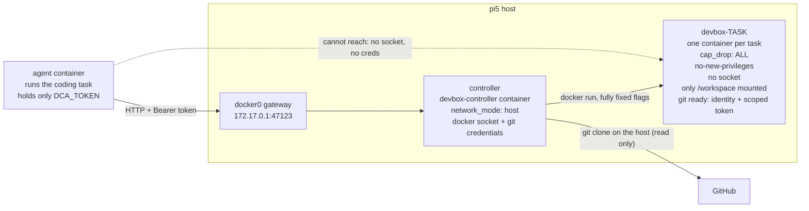
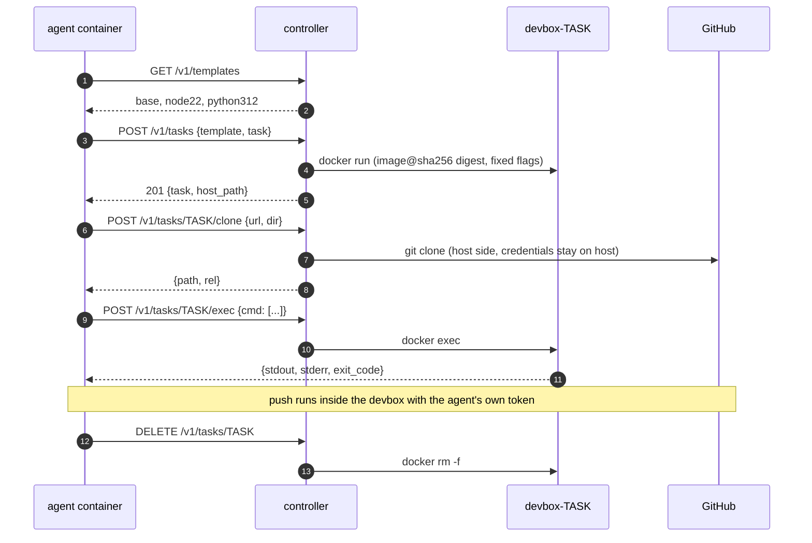

# devbox-controller

A small HTTP service that hands out disposable development containers ("devboxes") to an AI agent, without ever giving the agent a Docker socket.

Three roles, no A/B/C codenames:



| Role | What it is | What it holds | How it runs |
|---|---|---|---|
| **agent** | Your agent container, executing coding tasks | `DCA_TOKEN` (`DCA_URL` optional) | Default bridge is fine; reaches the controller via the bridge gateway `172.17.0.1:47123` |
| **controller** | `devbox-controller` container running `app.py` | Docker socket, git credentials | `network_mode: host`, listens on `0.0.0.0:47123` |
| **devbox** | `devbox-<task>` container, one per task | Only its `/workspace` | Created on demand by the controller |

**No `docker network create` anywhere.** The controller uses host networking; the agent stays on the default bridge. They meet at the bridge gateway, and the only authentication is a Bearer token.

> Answering "which IP?" — **a container sees its host as the gateway of the bridge it sits on.** For the default bridge that is `172.17.0.1`, unless the host's `daemon.json` overrides `bip`. When `DCA_URL` is unset, `dc` probes the local default gateway first, then `127.0.0.1`. Both are constants; no fixed subnet is needed.

## Lifecycle



Every step above is one HTTP call. The agent has no other way in: no socket, no host shell, no port that accepts unauthenticated calls.

## Why split it this way

| Problem | How it is handled |
|---|---|
| A Docker socket in the agent equals host root | The agent never mounts a socket; it only holds a token |
| `devcontainer.json` from a repo is an attack surface | It is never read. The environment is 100% decided by owner-written templates |
| The agent wants `--privileged` / `--mount` | There is no entry point for it: the API accepts only a template name, a task name and a command array |
| A devbox escape steals git credentials | Clone and push run on the host inside the controller. Devboxes contain zero credentials |
| A devbox attacks the controller | No token means `401` on every route, and the controller only ever touches containers carrying its own `devbox.owner` label |
| The machine cannot create Docker networks | No path calls `docker network create`; a devbox simply inherits the default bridge |
| The agent must not choose its own image | Templates are read-only to the agent, pin `@sha256` digests, and are validated as whole files |

## Deploy (on the host)

```sh
git clone https://github.com/sysnapse/devbox-controller.git
cd devbox-controller
./setup.sh                          # idempotent; safe to re-run
docker compose up -d --build
docker compose logs -f controller
```

`setup.sh` only touches the things that are easy to get wrong by hand:

| Step | What it does |
|---|---|
| `.env` | copies `.env.example` if missing; **never overwrites an existing token** |
| `DCA_TOKEN` | generates a 32-byte hex token if the value is empty or shorter than 16 chars |
| `DCA_HOST_WORK_ROOT` | defaults to `$PWD/work` (absolute), keeps your value if already set |
| work root | `mkdir -p`, then makes it writable by the uid the controller runs as |
| `DOCKER_GID` | reads the real group id off `/var/run/docker.sock` |
| `DCA_PORT` | migrates an old `8080` to `47123` |

The startup log should read:

```
devbox controller listening on 0.0.0.0:47123 (owner=agent, work_root=..., network=(docker default))
```

### Why the work root needs a host-side fix

The controller runs as an **unprivileged uid inside its container** (`DCA_UID`, default `1000`) so that files it clones stay writable inside the devbox, whose templates also use `1000:1000`. An unprivileged container **cannot `chown` the host side of a bind mount**, so the directory has to be prepared from the host, once:

```sh
# recommended: let setup.sh do it
./setup.sh

# or by hand
sudo mkdir -p /srv/devbox-work && sudo chown 1000:1000 /srv/devbox-work
# then set DCA_HOST_WORK_ROOT=/srv/devbox-work in .env
```

On a host where your own login is uid 1000 (common on a Pi), `mkdir work` as yourself is already enough — no `sudo` involved. If `DCA_HOST_WORK_ROOT` is not writable the controller **refuses to start** and prints the exact `chown` command with the real uid/gid, instead of failing later on the first task.

Changing `DCA_UID` means also passing the same value to the image build, and changing the `user:` in your templates:

```sh
docker compose build --build-arg DCA_UID=1001 --build-arg DCA_GID=1001
```

### Coming from an earlier build

```sh
docker compose down
docker rm -f $(docker ps -aq --filter label=devbox.owner=agent) 2>/dev/null
docker network rm dca-abnet dca-c 2>/dev/null   # only if you ever created them
```

## Self-check

From inside any bridge container (which is what the agent sees):

```sh
docker run --rm -e T="$DCA_TOKEN" curlimages/curl:latest \
  -s -H "Authorization: Bearer $T" http://172.17.0.1:47123/v1/health
```

From the host:

```sh
curl -s -H "Authorization: Bearer $DCA_TOKEN" http://127.0.0.1:47123/v1/health
```

Expect `200` and JSON. **Drop the header and you must get `401`** — that is the proof the token layer is actually doing something.

## Using it from the agent container

Put `client/dc` on the agent's `PATH` (it needs `python3`) and set one variable:

```sh
export DCA_TOKEN=<same value as .env>
# DCA_URL usually not needed: dc tries the local default gateway, then 127.0.0.1
# If the host overrides the docker bip, export DCA_URL=http://<your gateway>:47123
```

```sh
dc templates                      # list available templates
dc new node22 task-001            # start an empty devbox
dc exec task-001 -- git --version
dc clone task-001 https://github.com/you/repo.git
dc exec task-001 -- sh -lc 'cd repo && npm ci && npm test'
# push from inside the devbox, with your own token (never through the controller)
dc exec task-001 -- sh -lc 'cd repo && git push -u origin HEAD'
dc rm task-001
```

**Wrap composite commands in `sh -lc '...'`.** The command is passed as an argv array and never goes through a host shell, so pipes and `&&` only work if you explicitly ask a shell inside the devbox to interpret them.

## Templates shipped

34 templates cover the mainstream languages. Every one of them is checked at
render time with `tools/update-templates.py`, which resolves the image against its
registry, pins the digest, and refuses any image with no `linux/arm64` manifest,
because the devbox host is a Pi 5. `lua`, `kotlin`, `scala` and `zig` have no
usable arm64 official image, so they are handled differently (see the notes below
the table).

| template | image | limits | packages installed at create | notes |
|---|---|---|---|---|
| `base` | `alpine:3.21` | 1 cpu / 1g | git | minimal Alpine toolchain; use a language template for real work |
| `bun` | `oven/bun:1-alpine` | 2 cpu / 2g | git | Bun runtime and package manager |
| `c` | `alpine:3.21` | 2 cpu / 2g | build-base, git, cmake, cmocka-dev | C toolchain: gcc, make, cmake, cmocka |
| `clojure` | `clojure:temurin-25-tools-deps-bookworm-slim` | 2 cpu / 4g | git | Clojure with the Clojure CLI and tools.deps |
| `cpp` | `alpine:3.21` | 2 cpu / 2g | build-base, git, cmake | C++ toolchain: g++, make, cmake |
| `crystal` | `crystallang/crystal:1.22.3-alpine` | 2 cpu / 4g | git, build-base | Crystal 1.22 with shards |
| `dart` | `dart:stable` | 2 cpu / 4g | git | Dart SDK with pub |
| `deno` | `denoland/deno:alpine` | 2 cpu / 2g | git | Deno runtime (TypeScript out of the box) |
| `dotnet` | `mcr.microsoft.com/dotnet/sdk:10.0` | 2 cpu / 6g | git | dotnet SDK 10 (C#, F#, VB); Debian base from mcr.microsoft.com |
| `elixir` | `elixir:1.20-alpine` | 2 cpu / 4g | git, build-base | Elixir with mix and iex; build-base for NIFs |
| `erlang` | `erlang:28-alpine` | 2 cpu / 4g | git, build-base | Erlang/OTP 28 with rebar3 |
| `fortran` | `gcc:15` | 2 cpu / 2g | git | GFortran from the official GCC image (Debian base, gfortran already present) |
| `go` | `golang:1.27-alpine` | 2 cpu / 4g | git, make | Go toolchain; the image already carries git |
| `groovy` | `groovy:jdk21-noble` | 2 cpu / 4g | git | Groovy with the JDK 21 image underneath |
| `haskell` | `haskell:9.12` | 2 cpu / 6g | git | GHC 9.12 with cabal and stack; heavy image, pull only when needed |
| `java17` | `eclipse-temurin:17-jdk` | 2 cpu / 4g | git | JDK 17 with javac; Debian base because 17-jdk-alpine has no arm64 build |
| `java21` | `eclipse-temurin:21-jdk-alpine` | 2 cpu / 4g | git | JDK 21 with javac |
| `java25` | `eclipse-temurin:25-jdk-alpine` | 2 cpu / 4g | git | JDK 25 with javac |
| `julia` | `julia:1.12` | 2 cpu / 6g | git | Julia 1.12 with the package manager; heavy image |
| `kotlin` | `eclipse-temurin:21-jdk-alpine` | 2 cpu / 4g | git | JDK 21 base; no arm64 official Kotlin image exists, so install kotlinc inside |
| `lua` | `alpine:3.21` | 1 cpu / 1g | lua5.4, git | Lua 5.4; luarocks is not packaged for Alpine 3.21, install it with the agent if needed |
| `nim` | `nimlang/nim:2.2.0` | 2 cpu / 2g | git | Nim 2.2 with nimble (2.4.0 is amd64-only, so 2.2.0 is pinned) |
| `node22` | `node:22-alpine` | 2 cpu / 4g | git | Node.js 22 LTS with npm; git is already in the image |
| `node24` | `node:24-alpine` | 2 cpu / 4g | git | Node.js 24 with npm |
| `ocaml` | `ocaml/opam:debian-12-ocaml-5.3` | 2 cpu / 4g | git | OCaml 5.3 with opam and dune |
| `perl` | `perl:5.42-slim` | 2 cpu / 2g | git, build-essential | Perl 5.42 with cpan; build-essential for XS modules |
| `php` | `php:8.5-alpine` | 2 cpu / 4g | git | PHP 8.5 CLI; composer is not an Alpine package, fetch it with the agent |
| `python311` | `python:3.11-alpine` | 2 cpu / 4g | git, build-base | Python 3.11 with pip; build-base for C extensions |
| `python312` | `python:3.12-alpine` | 2 cpu / 4g | git, build-base | Python 3.12 with pip; build-base for C extensions |
| `python313` | `python:3.13-alpine` | 2 cpu / 4g | git, build-base | Python 3.13 with pip; build-base for C extensions |
| `r` | `r-base:4.5.2` | 2 cpu / 4g | git | R 4.5 with install.packages support |
| `ruby` | `ruby:3.4-alpine` | 2 cpu / 4g | git, build-base, yaml-dev | Ruby 3.4 with bundler; build-base for native gems |
| `rust` | `rust:1.100-alpine` | 2 cpu / 4g | git, build-base | rustc and cargo; build-base is needed to link musl targets |
| `swift` | `swift:6.2` | 2 cpu / 6g | git | Swift 6.2 toolchain (Debian base); heavy image |

Pick a template by language, not by version, unless you need a specific one:
`node22` and `node24` both exist, as do `python311`, `python312` and `python313`,
`java17`, `java21` and `java25`.

### Adding or refreshing one

The table in `tools/update-templates.py` is the only place that needs editing:

```sh
# resolve every image, verify arm64, write templates/*.yml
python3 tools/update-templates.py

# same, but write nothing (use this in CI or before a commit)
python3 tools/update-templates.py --check

# one template
python3 tools/update-templates.py --only rust
```

Each run resolves the digest live, so refreshing a language is a version bump plus
a rerun. `tools/pin-images.py <ref>` prints the digest and platforms for any image;
`tools/image-config.py <ref>` prints its ENTRYPOINT, USER and WORKDIR, which tells
you whether `sleep infinity` will start it (`docker run` only overrides CMD).

### Languages without an arm64 official image

| language | status | what this repo does instead |
|---|---|---|
| Kotlin | no official image at all | `kotlin` template is the JDK 21 base; install `kotlinc` inside |
| Scala | no official image at all | use `java21`, install `scala-cli` or `sbt` inside |
| Zig | no Docker Hub repo (`ghcr.io/ziglang/zig` needs auth, unverified) | use `base`/`c` and download the tarball inside |
| Lua | `library/lua` returns 401 (removed) and `luarocks` is not packaged for Alpine 3.21 | `lua` template is `alpine` + `lua5.4` |
| Nim | 2.4.0 is amd64-only | pinned to 2.2.0, the newest arm64 tag |
| Java 17 | `17-jdk-alpine` has no arm64 build | `java17` uses the Debian `17-jdk` variant |
| Crystal | `1.14-alpine` is amd64-only | pinned to `1.22.3-alpine`, which is arm64 |

### Disk cost (read this before creating one of everything)

Images are pulled the first time a template is used, not when the file is added, so
having 34 templates costs nothing until you `dc new` into them. But the heavy ones
are heavy: `swift`, `haskell`, `dotnet` and `julia` are multi-GB each, and the whole
set is roughly 15-20 GB.

On the Pi 5 the docker data-root sits on the SD card, so pulling all of them wears
the card and can fill it. Create only what you need, and remove images with:

```sh
docker image ls --filter label=devbox --format '{{.Repository}}:{{.Tag}} {{.Size}}'
docker image rm <image>            # per image
docker image prune -a              # every image no container uses, ask first
```

`dc rm <task>` removes the container; it does not remove the image.

## Writing a template

One file per template at `templates/<name>.yml` — plain YAML, parsed with `yaml.safe_load`, not a custom format:

```yaml
name: node22
image: node:22-alpine@sha256:1314fb30...   # digest is mandatory
workdir: /workspace
network: default      # default = inherit the default bridge; none = no network; other = an existing network name
cpus: 2
memory: 4g
pids: 512
user: "1000:1000"
packages: [git]       # optional, installed with apk at create time
```

- Only those nine keys (plus `notes`) are accepted. Any other key, such as `privileged`, rejects the whole file.
- Values must be scalars (string, integer or float), except `packages`, which is the one allowed list:
  at most 12 entries, each matching `[a-z0-9][a-z0-9._+-]*`. That regex is what stops a template from
  smuggling `git; rm -rf /` into the `apk add` line. Nested mappings and booleans are still rejected,
  so `user: true` cannot be silently read as the string `true`.
- `packages` exist so a stock `alpine`, `node:22-alpine` or `python:3.12-alpine` image can still run git:
  they are installed as root right after the container starts. If the install fails, `dc new` still
  succeeds and reports `packages: failed: ...` instead of pretending the box is complete.
- `image` without `@sha256:` is rejected unless `DCA_ALLOW_TAGS=1`, which is not recommended.
- The template directory is mounted `:ro` into the controller and is invisible to the agent, so the agent cannot edit it.
- Legacy `*.tpl` files are still read during migration; when both `foo.yml` and `foo.tpl` exist, `foo.yml` wins. New templates should be `.yml` only.

### Built-in copies (why the API is never template-less)

The image also carries a copy of `templates/` at `/opt/templates`. Resolution order is the mounted directory first, then the built-in copy. This exists because of a real failure: if `docker compose` is started from a directory where `./templates` does not exist, Docker creates an *empty* directory for the bind mount, the controller then reports `[]` templates, and every `dc new` fails with `no such template`.

The build context is therefore the repository root (`context: .`, `dockerfile: controller/Dockerfile`), not `./controller`. If you edit `templates/*.yml`, rebuild with `docker compose up -d --build`; a plain restart will not refresh the built-in copies.

`templates/base.yml` is the only template that should ever need editing for local mirrors; keep the digest lines intact.

## Git

Two ways to move code, both use the same token:

### 1. Inside the devbox (default)

At container creation the controller writes three files as root, then the devbox is a normal
git checkout away from working:

| Path | Contents |
|---|---|
| `/etc/gitconfig` | `user.name`, `user.email`, `credential.helper`, `init.defaultBranch=main`, `safe.directory=*` |
| `/usr/local/bin/git-credential-devbox` | credential helper that prints the token as the password |
| `/etc/devbox-git-token` | the token itself, mode `0644` |

So this works with no setup at all:

```sh
dc exec mytask -- git clone https://github.com/you/repo.git
dc exec mytask -- sh -c 'cd repo && echo x >> f && git commit -am wip && git push'
```

- The identity comes from `DCA_GIT_NAME` / `DCA_GIT_EMAIL`, not from a host `~/.gitconfig`.
- The token is written **over stdin**, so it never appears in `docker run` argv, `docker inspect`,
  a process listing, or `.git/config`; `url.insteadOf` is not used, so remotes stay clean.
- `git` has to exist in the image. The bundled templates install it with `packages: [git]`.
  If a template has no `packages`, `dc new` reports `git: skipped (git not installed: ...)`.
- Tools that want a token in the environment can `export GH_TOKEN=$(cat /etc/devbox-git-token)`.
- `DCA_INJECT_GIT=0` turns all of this off, so the token stays on the controller side only.

### 2. `dc clone` only, on the controller

`dc clone <task> <url> [dir]` runs `git clone` **on the host** in the controller process,
which keeps a read token out of the devbox. There is **no `dc push`**: pushing is always
done by the agent inside the devbox with the agent's own token, so a compromised devbox
cannot borrow the controller's write credential. The token for clone is passed through the
process environment and an inline credential helper, never in argv and never in `.git/config`.

```sh
git -c credential.helper= \
    -c 'credential.helper=!f() { echo username=${DCA_GIT_USER}; echo password=${DCA_GIT_TOKEN}; }; f' \
    clone -- <url> <dest>
```

Without a token only public repositories clone.

### Scope the token, and know what the devbox can see

Use a fine-grained PAT limited to the repositories the agent may touch, with `contents: write`.
A classic token carrying org/admin scopes is overkill and widens the blast radius of a leak.

Be honest about the trade: a token you use inside a devbox is readable by anything running in
that devbox (env or file — same access either way). Devboxes share the default bridge with the
agent container, so code you run there can also try to reach the agent. The controller does not
hold or relay a push credential at all, so the blast radius of a devbox is limited to the token
that agent chose to bring, and to that run only.

Push from the devbox like this, without writing the token to `.git/config`:

```sh
# token from your own environment, read inside the container
dc exec task-001 -- sh -lc 'cd repo && git -c credential.helper="!f() { echo username=x-access-token; echo password=$GH_TOKEN; }; f" push -u origin HEAD'
```

## Narrowing egress (optional, not built in)

A devbox on the default bridge can reach the public internet and also the host's internal networks. To block the latter, add nftables rules **on the host** (`apk add nftables`):

```sh
nft add table inet dca
nft 'add chain inet dca fwd { type filter hook forward priority -10; policy accept; }'
nft add rule inet dca fwd iifname "docker0" ip daddr { 10.0.0.0/8, 192.168.0.0/16, 172.16.0.0/12, 169.254.0.0/16, 127.0.0.0/8 } counter drop
nft add rule inet dca fwd iifname "docker0" ip6 daddr { fc00::/7, fe80::/10, ::1/128 } counter drop
```

Devboxes still need the public internet for `git clone` and package installs, so only the internal direction is dropped. If the target machine cannot take nftables rules at all, this section is not available — see limit 6 below.

## Configuration

| Variable | Default | Meaning |
|---|---|---|
| `DCA_TOKEN` | none (required) | Bearer token, at least 16 characters; generate with `openssl rand -hex 32` |
| `DCA_HOST_WORK_ROOT` | none (required) | Host path, mounted into the controller under the identical path |
| `DCA_BIND` | `0.0.0.0` | Controller bind address. `127.0.0.1` only works for host-network callers, so a bridge agent cannot connect |
| `DCA_PORT` | `47123` | Controller listen port |
| `DCA_NETWORK` | empty | Default devbox network; empty or `default` means no `--network` flag |
| `DCA_OWNER` | `agent` | Container label the controller is allowed to manage |
| `DCA_EXEC_TIMEOUT` | `900` | Per-exec timeout in seconds |
| `DCA_IDLE_HOURS` | `0` | If > 0, periodically stop idle tasks |
| `DCA_ALLOW_TAGS` | `0` | Allow image tags instead of digests (not recommended) |
| `DCA_ALLOW_PRIVATE_URL` | `0` | Allow cloning private/internal URLs (not recommended) |
| `DCA_GIT_TOKEN` | empty | Read token for `dc clone` only; copied into each devbox when injection is on. Not used for push |
| `DCA_GIT_USER` | `x-access-token` | Username paired with `DCA_GIT_TOKEN` |
| `DCA_INJECT_GIT` | `1` | Write identity, credential helper and token into each devbox; `0` keeps the token on the controller |
| `DCA_GIT_NAME` / `DCA_GIT_EMAIL` | `sysnapse` / `8198069+sysnapse@users.noreply.github.com` | Commit identity inside devboxes |

## What has been tested

Measured locally, against a fake docker shim and a live HTTP server:

- 32 unit tests pass: template traversal, tag rejection, unknown/`privileged` keys, `..` in paths, internal URLs, task-name injection, exec string injection, network-field handling
- Real HTTP: health without a token returns `401`; templates and create return `200` / `201`
- The exact `docker run` argv was inspected line by line: no privileged flag, no socket, resource limits present, no `--network` by default
- `py_compile` passes on both `app.py` and `dc`

Measured against a real Pi 5 deployment:

- Controller image builds and starts; `401` without a token, `200` with one
- `GET /v1/templates` returns all three templates with digests
- The controller is reachable from a bridge container on a non-default bridge (`172.23.x`), confirming the gateway-probing logic rather than a hardcoded `172.17.0.1`

Not yet verified: a devbox actually starting end to end on pi5, arm64 digest pulls, and `group_add` picking up the docker socket.

## Known limits (honest list)

1. **Devbox escape is the one big risk.** Shared kernel, so it takes a real kernel or runc CVE, but success means pi5 root, because dockerd runs as root. Only rootless dockerd narrows this.
2. **The controller is a new trust root.** Compromising it is equivalent to host root. Its image carries only python3, docker-cli, git and openssh-client.
3. **Repo code still executes** (`npm ci`, `make`, `pytest`). That is the product working as intended; the blast radius starts inside the devbox.
4. **The token is the only authentication.** No network segmentation, and the controller binds `0.0.0.0`:
   - a leaked token means anyone can create devboxes;
   - `0.0.0.0` means both the internal network and every Docker bridge can reach `47123`, so the token is the only wall; use at least 32 bytes and rotate it;
   - devboxes share the default bridge with the agent, so code inside a devbox can reach the agent container and try to steal its token. This is the direct cost of giving up network segmentation, and it is one grade weaker than a dedicated-network design.
5. **If the agent also has a host shell, the whole design is void.** The agent must genuinely have only the HTTP path.
6. **No segmentation means no second wall.** If the token leaks, or the controller has an RCE, there is no network layer left to buy time.
7. **`172.17.0.1` is only the default-bridge gateway.** If the host sets `bip` or `default-address-pools` in `daemon.json`, or the container is attached to a custom network, set `DCA_URL` yourself.
8. **Resource reclamation is not enforced.** `DCA_IDLE_HOURS` defaults to `0` (never reclaim), so long-lived devboxes accumulate.
