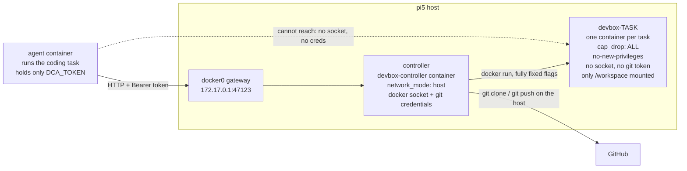
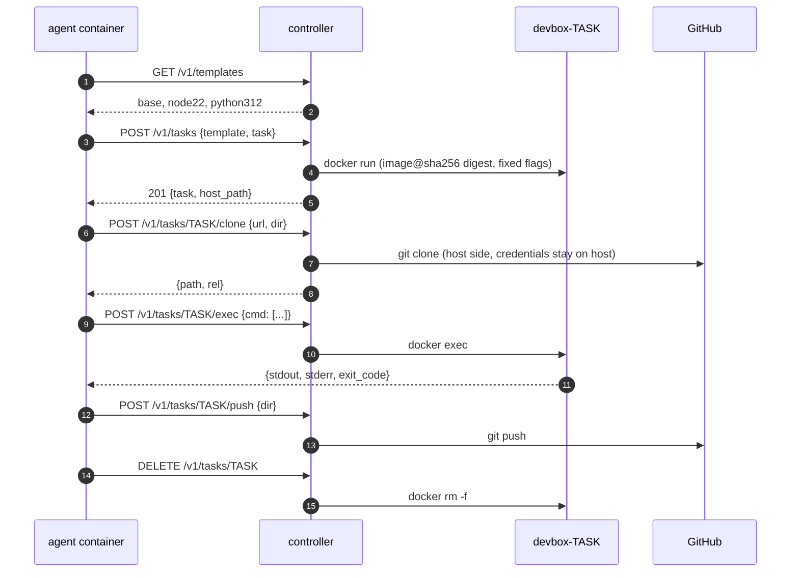

# devbox-controller

A small HTTP service that hands out disposable development containers ("devboxes") to an AI agent, without ever giving the agent a Docker socket.

Three roles, no A/B/C codenames:



| Role | What it is | What it holds | How it runs |
|---|---|---|---|
| **agent** | Your agent container, executing coding tasks | `DCA_TOKEN` (`DCA_URL` optional) | Default bridge is fine; reaches the controller via the bridge gateway `172.17.0.1:47123` |
| **controller** | `devbox-controller` container running `app.py` | Docker socket, git credentials | `network_mode: host`, listens on `0.0.0.0:47123` |
| **devbox** | `devbox-<task>` container, one per task | Only its `/workspace` | Created on demand by the controller |

**No `docker network create` anywhere.** The controller uses host networking; the agent stays on the default bridge. They meet at the bridge gateway, and the only authentication is a Bearer token.

> Answering "which IP?" — **a container sees its host as the gateway of the bridge it sits on.** For the default bridge that is `172.17.0.1`, unless the host's `daemon.json` overrides `bip`. When `DCA_URL` is unset, `dc` probes the local default gateway first, then `127.0.0.1`. Both are constants; no fixed subnet is needed.

## Lifecycle



Every step above is one HTTP call. The agent has no other way in: no socket, no host shell, no port that accepts unauthenticated calls.

## Why split it this way

| Problem | How it is handled |
|---|---|
| A Docker socket in the agent equals host root | The agent never mounts a socket; it only holds a token |
| `devcontainer.json` from a repo is an attack surface | It is never read. The environment is 100% decided by owner-written templates |
| The agent wants `--privileged` / `--mount` | There is no entry point for it: the API accepts only a template name, a task name and a command array |
| A devbox escape steals git credentials | Clone and push run on the host inside the controller. Devboxes contain zero credentials |
| A devbox attacks the controller | No token means `401` on every route, and the controller only ever touches containers carrying its own `devbox.owner` label |
| The machine cannot create Docker networks | No path calls `docker network create`; a devbox simply inherits the default bridge |
| The agent must not choose its own image | Templates are read-only to the agent, pin `@sha256` digests, and are validated as whole files |

## Deploy (on the host)

```sh
git clone https://github.com/sysnapse/devbox-controller.git
cd devbox-controller
./setup.sh                          # idempotent; safe to re-run
docker compose up -d --build
docker compose logs -f controller
```

`setup.sh` only touches the things that are easy to get wrong by hand:

| Step | What it does |
|---|---|
| `.env` | copies `.env.example` if missing; **never overwrites an existing token** |
| `DCA_TOKEN` | generates a 32-byte hex token if the value is empty or shorter than 16 chars |
| `DCA_HOST_WORK_ROOT` | defaults to `$PWD/work` (absolute), keeps your value if already set |
| work root | `mkdir -p`, then makes it writable by the uid the controller runs as |
| `DOCKER_GID` | reads the real group id off `/var/run/docker.sock` |
| `DCA_PORT` | migrates an old `8080` to `47123` |

The startup log should read:

```
devbox controller listening on 0.0.0.0:47123 (owner=agent, work_root=..., network=(docker default))
```

### Why the work root needs a host-side fix

The controller runs as an **unprivileged uid inside its container** (`DCA_UID`, default `1000`) so that files it clones stay writable inside the devbox, whose templates also use `1000:1000`. An unprivileged container **cannot `chown` the host side of a bind mount**, so the directory has to be prepared from the host, once:

```sh
# recommended: let setup.sh do it
./setup.sh

# or by hand
sudo mkdir -p /srv/devbox-work && sudo chown 1000:1000 /srv/devbox-work
# then set DCA_HOST_WORK_ROOT=/srv/devbox-work in .env
```

On a host where your own login is uid 1000 (common on a Pi), `mkdir work` as yourself is already enough — no `sudo` involved. If `DCA_HOST_WORK_ROOT` is not writable the controller **refuses to start** and prints the exact `chown` command with the real uid/gid, instead of failing later on the first task.

Changing `DCA_UID` means also passing the same value to the image build, and changing the `user:` in your templates:

```sh
docker compose build --build-arg DCA_UID=1001 --build-arg DCA_GID=1001
```

### Coming from an earlier build

```sh
docker compose down
docker rm -f $(docker ps -aq --filter label=devbox.owner=agent) 2>/dev/null
docker network rm dca-abnet dca-c 2>/dev/null   # only if you ever created them
```

## Self-check

From inside any bridge container (which is what the agent sees):

```sh
docker run --rm -e T="$DCA_TOKEN" curlimages/curl:latest \
  -s -H "Authorization: Bearer $T" http://172.17.0.1:47123/v1/health
```

From the host:

```sh
curl -s -H "Authorization: Bearer $DCA_TOKEN" http://127.0.0.1:47123/v1/health
```

Expect `200` and JSON. **Drop the header and you must get `401`** — that is the proof the token layer is actually doing something.

## Using it from the agent container

Put `client/dc` on the agent's `PATH` (it needs `python3`) and set one variable:

```sh
export DCA_TOKEN=<same value as .env>
# DCA_URL usually not needed: dc tries the local default gateway, then 127.0.0.1
# If the host overrides the docker bip, export DCA_URL=http://<your gateway>:47123
```

```sh
dc templates                      # list available templates
dc new node22 task-001            # start an empty devbox
dc exec task-001 -- git --version
dc clone task-001 https://github.com/you/repo.git
dc exec task-001 -- sh -lc 'cd repo && npm ci && npm test'
dc push task-001 repo
dc rm task-001
```

**Wrap composite commands in `sh -lc '...'`.** The command is passed as an argv array and never goes through a host shell, so pipes and `&&` only work if you explicitly ask a shell inside the devbox to interpret them.

## Writing a template

One file per template at `templates/<name>.tpl`, one `key: value` per line:

```yaml
name: node22
image: node:22-alpine@sha256:1314fb30...   # digest is mandatory
workdir: /workspace
network: default      # default = inherit the default bridge; none = no network; other = an existing network name
cpus: 2
memory: 4g
pids: 512
user: "1000:1000"
```

- Only those eight keys (plus `notes`) are accepted. Any other key, such as `privileged`, rejects the whole file.
- `image` without `@sha256:` is rejected unless `DCA_ALLOW_TAGS=1`, which is not recommended.
- The template directory is mounted `:ro` into the controller and is invisible to the agent, so the agent cannot edit it.

## Narrowing egress (optional, not built in)

A devbox on the default bridge can reach the public internet and also the host's internal networks. To block the latter, add nftables rules **on the host** (`apk add nftables`):

```sh
nft add table inet dca
nft 'add chain inet dca fwd { type filter hook forward priority -10; policy accept; }'
nft add rule inet dca fwd iifname "docker0" ip daddr { 10.0.0.0/8, 192.168.0.0/16, 172.16.0.0/12, 169.254.0.0/16, 127.0.0.0/8 } counter drop
nft add rule inet dca fwd iifname "docker0" ip6 daddr { fc00::/7, fe80::/10, ::1/128 } counter drop
```

Devboxes still need the public internet for `git clone` and package installs, so only the internal direction is dropped. If the target machine cannot take nftables rules at all, this section is not available — see limit 6 below.

## Configuration

| Variable | Default | Meaning |
|---|---|---|
| `DCA_TOKEN` | none (required) | Bearer token, at least 16 characters; generate with `openssl rand -hex 32` |
| `DCA_HOST_WORK_ROOT` | none (required) | Host path, mounted into the controller under the identical path |
| `DCA_BIND` | `0.0.0.0` | Controller bind address. `127.0.0.1` only works for host-network callers, so a bridge agent cannot connect |
| `DCA_PORT` | `47123` | Controller listen port |
| `DCA_NETWORK` | empty | Default devbox network; empty or `default` means no `--network` flag |
| `DCA_OWNER` | `agent` | Container label the controller is allowed to manage |
| `DCA_EXEC_TIMEOUT` | `900` | Per-exec timeout in seconds |
| `DCA_IDLE_HOURS` | `0` | If > 0, periodically stop idle tasks |
| `DCA_ALLOW_TAGS` | `0` | Allow image tags instead of digests (not recommended) |
| `DCA_ALLOW_PRIVATE_URL` | `0` | Allow cloning private/internal URLs (not recommended) |

## What has been tested

Measured locally, against a fake docker shim and a live HTTP server:

- 32 unit tests pass: template traversal, tag rejection, unknown/`privileged` keys, `..` in paths, internal URLs, task-name injection, exec string injection, network-field handling
- Real HTTP: health without a token returns `401`; templates and create return `200` / `201`
- The exact `docker run` argv was inspected line by line: no privileged flag, no socket, resource limits present, no `--network` by default
- `py_compile` passes on both `app.py` and `dc`

Measured against a real Pi 5 deployment:

- Controller image builds and starts; `401` without a token, `200` with one
- `GET /v1/templates` returns all three templates with digests
- The controller is reachable from a bridge container on a non-default bridge (`172.23.x`), confirming the gateway-probing logic rather than a hardcoded `172.17.0.1`

Not yet verified: a devbox actually starting end to end on pi5, arm64 digest pulls, and `group_add` picking up the docker socket.

## Known limits (honest list)

1. **Devbox escape is the one big risk.** Shared kernel, so it takes a real kernel or runc CVE, but success means pi5 root, because dockerd runs as root. Only rootless dockerd narrows this.
2. **The controller is a new trust root.** Compromising it is equivalent to host root. Its image carries only python3, docker-cli, git and openssh-client.
3. **Repo code still executes** (`npm ci`, `make`, `pytest`). That is the product working as intended; the blast radius starts inside the devbox.
4. **The token is the only authentication.** No network segmentation, and the controller binds `0.0.0.0`:
   - a leaked token means anyone can create devboxes;
   - `0.0.0.0` means both the internal network and every Docker bridge can reach `47123`, so the token is the only wall; use at least 32 bytes and rotate it;
   - devboxes share the default bridge with the agent, so code inside a devbox can reach the agent container and try to steal its token. This is the direct cost of giving up network segmentation, and it is one grade weaker than a dedicated-network design.
5. **If the agent also has a host shell, the whole design is void.** The agent must genuinely have only the HTTP path.
6. **No segmentation means no second wall.** If the token leaks, or the controller has an RCE, there is no network layer left to buy time.
7. **`172.17.0.1` is only the default-bridge gateway.** If the host sets `bip` or `default-address-pools` in `daemon.json`, or the container is attached to a custom network, set `DCA_URL` yourself.
8. **Resource reclamation is not enforced.** `DCA_IDLE_HOURS` defaults to `0` (never reclaim), so long-lived devboxes accumulate.
